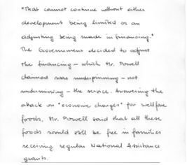
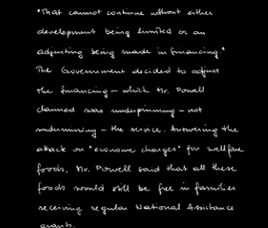
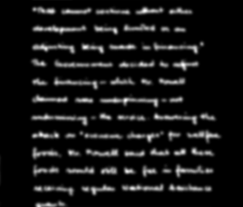
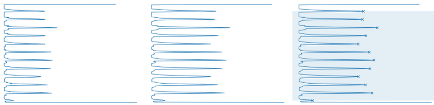
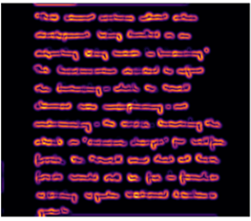
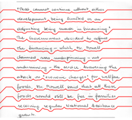

# IAM Line Segmentation Using Seam Carving

This algorithm segments handwritten text lines from the IAM dataset using seam carving.

The idea of combining the horizontal projection profile with seam carving is inspired by [Das and Panda (2023)](https://doi.org/10.1016/j.rineng.2023.101110); the implementation and processing steps differ from the original work.

## Pipeline

1. **Region of Interest Extraction:** Crops the handwritten region between the last two horizontal divider lines of the form.

2. **Otsu Binarization:** Converts the grayscale image into a binary image.

3. **Gaussian Filtering:** Smooths the binary image so that the energy map forms continuous regions around the text.

4. **Horizontal Projection Profile:** Computes and smooths the HPP of the binary image to detect peaks and define line blocks.

5. **Energy Map Generation:** Computes an energy map from the Gaussian-filtered image.

6. **Seam Carving:** Finds low-energy horizontal seams within each block to segment the handwritten lines.

## Usage

Open `seam_carving_line_segmentation.ipynb` and run all cells. The notebook installs the dependencies, downloads the dataset through `kagglehub` (Kaggle credentials may be required) and saves the results to `subset_50/`.

## Dataset

This project uses the [IAM Handwriting Database](https://fki.tic.heia-fr.ch/databases/iam-handwriting-database), downloaded from a [Kaggle mirror](https://www.kaggle.com/datasets/naderabdelghany/iam-handwritten-forms-dataset). The IAM database is available for non-commercial research use under its own terms of use. The example images in this repository are derived from it.

## Limitations

- Evaluation is qualitative (visual inspection); no quantitative metric is computed.
- Results were inspected on a random subset of 50 forms.

## References

- M. Das and M. Panda. *Seam carving, horizontal projection profile and contour tracing for line and word segmentation of language independent handwritten documents.* Results in Engineering, 18:101110, 2023. https://doi.org/10.1016/j.rineng.2023.101110
- U.-V. Marti and H. Bunke. *The IAM-database: an English sentence database for offline handwriting recognition.* International Journal on Document Analysis and Recognition, 5:39–46, 2002.
- S. Avidan and A. Shamir. *Seam Carving for Content-Aware Image Resizing.* ACM Transactions on Graphics (SIGGRAPH), 2007.

## License

This code is released under the MIT License. See [LICENSE](LICENSE) for details.
